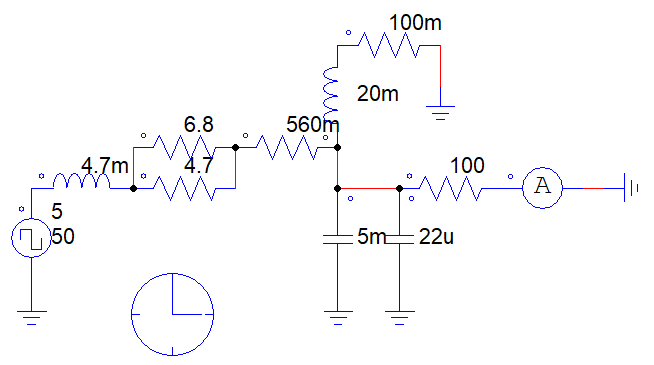
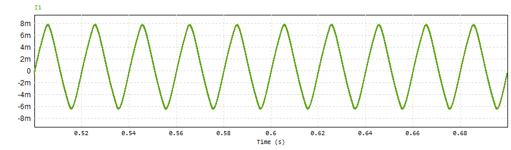
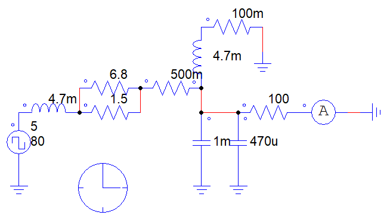
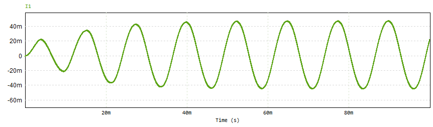
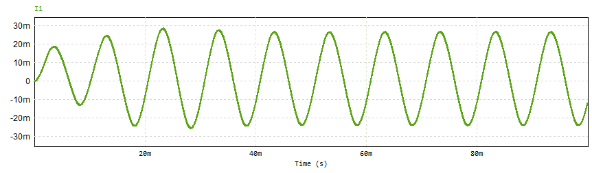

# PSIM Square Wave to Sine Filter

Experiments in PSIM that turn a square wave into a sine-like current with a
passive RLC network, at 50, 80 and 100 Hz.

There is no switching element in these circuits. The 5 V square-wave source
stands in for the output of a square-wave inverter, and the RLC network acts
as its output filter: it passes the fundamental and attenuates the higher
harmonics, so the current in the 100 Ω load comes out close to a sine wave.

These are exploratory circuits. The component values were tuned by trial,
not from a filter design procedure, and the 50 Hz version still shows a small
offset (about +8 mA / −6 mA peaks).

## Circuits

| Frequency | Series L | Parallel R | Series R | L–R branch | Shunt C | Load current |
|-----------|----------|------------|----------|------------|---------|--------------|
| 50 Hz | 4.7 mH | 6.8 Ω ∥ 4.7 Ω | 560 mΩ | 20 mH + 100 mΩ | 5 mF ∥ 22 µF | ≈ 7 mA peak |
| 80 Hz | 4.7 mH | 6.8 Ω ∥ 1.5 Ω | 500 mΩ | 4.7 mH + 100 mΩ | 1 mF ∥ 470 µF | ≈ 45 mA peak |
| 100 Hz | 4.7 mH | 6.8 Ω ∥ 1.5 Ω | 500 mΩ | 4.7 mH + 100 mΩ | 1 mF ∥ 470 µF | ≈ 25 mA peak |

### 50 Hz

### 80 Hz

### 100 Hz

## Tools
PSIM
